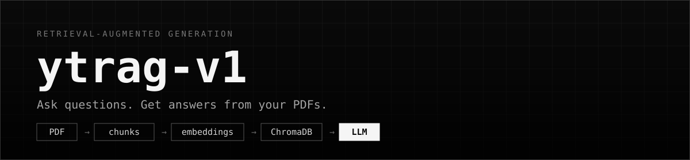
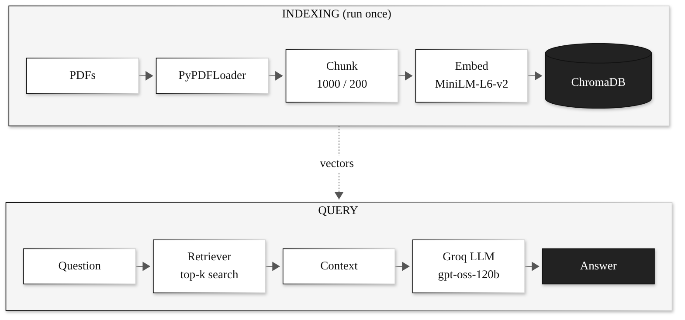

<p align="center">
  
</p>

<p align="center">
  
  
  
  
  
</p>

<p align="center">
  A small Retrieval-Augmented Generation pipeline: load PDFs, chunk them, embed the chunks,<br>
  store them in ChromaDB, and answer questions with a Groq-hosted LLM using the retrieved context.
</p>

---

## Flow

<p align="center">
  
</p>

## Pipeline

| # | Step | What it does |
|---|------|--------------|
| 1 | **Ingest** | Loads every PDF under `data/` with `PyPDFLoader` |
| 2 | **Chunk** | `RecursiveCharacterTextSplitter`, 1000 chars with 200 overlap |
| 3 | **Embed** | `all-MiniLM-L6-v2` via `sentence-transformers` |
| 4 | **Store** | Persistent ChromaDB collection in `data/vector_store/` |
| 5 | **Retrieve** | `RAGRetriever` runs similarity search with a score threshold |
| 6 | **Generate** | `ChatGroq` (`openai/gpt-oss-120b`) answers from the retrieved context |

`rag_simple` is the basic version. `rag_advanced` adds score filtering and optional context return.

## Layout

```text
notebook/
  document.ipynb      LangChain Document structure + sample text files
  pdf_loader.ipynb    full pipeline: ingest > chunk > embed > store > retrieve > LLM
data/
  pdf/                sample PDFs (attention, embeddings, object detection)
  text_files/         sample .txt files (Python intro, machine learning)
  vector_store/       generated ChromaDB files (git-ignored)
docs/                 banner and flowchart images
main.py               placeholder entry point
pyproject.toml        dependencies (uv)
requirements.txt      same dependencies, pip-style
```

## Setup

Requires Python 3.13+ and a [Groq API key](https://console.groq.com/keys).

```bash
uv sync                      # or: pip install -r requirements.txt
cp .env.example .env         # then put your key in .env
```

Open `notebook/pdf_loader.ipynb` and run the cells top to bottom. The vector store is rebuilt on the first run.

## Status

| Done | Not done |
|------|----------|
| Ingest, chunk, embed, store, retrieve, answer (in the notebook) | Move the notebook code into a Python module or CLI (`main.py` is still a stub) |
| | UI |
| | YouTube ingestion |
